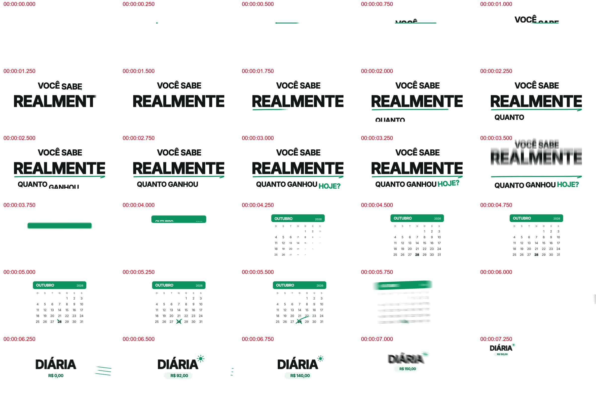
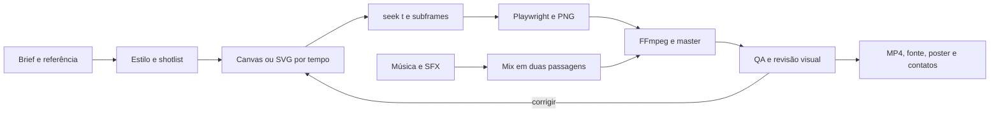

# Motion Video Studio

**Uma skill de produção de vídeos para Claude Code e Codex, com scripts prontos, referência analisada e um motor de renderização local.**

Transforme briefing, marca e referência em animação editável, áudio, frames revisados e MP4. O pacote organiza o método do artigo de [Movez — How to build motion design studio with Opus 5.5](https://x.com/0xMovez/status/2104216919033192746) em uma ferramenta reutilizável: **referência → direção → estados → código → crítica → render → verificação**.

Não exige API de vídeo nem créditos de geração. Claude Code ou Codex precisa ter acesso a arquivos e terminal. A skill orienta o agente e fornece ferramentas; não altera os pesos do modelo nem garante um resultado profissional sem direção e revisão.

[Começar](#instalação-rápida) · [Como usar](#uso-no-claude-code-e-no-codex) · [Scripts](references/scripts.md) · [Análise do exemplo](references/reference-analysis.md) · [Base no artigo](references/article-map.md)

## O que vem pronto

| Capacidade | Implementação |
|---|---|
| Render determinístico | HTML/Canvas + `window.seek(t)` + Playwright |
| Exportação | FFmpeg, H.264/yuv420p, CRF 16, MP4 faststart |
| Motion blur | Quatro subframes temporais por frame, configurável |
| Movimento | Molas analíticas, retarget contínuo, indicadores e troca de conteúdo |
| Elementos 3D | Three.js 0.187.0, cena de produto, câmera, PBR, luz, sombras e glTF |
| Áudio | Trilha original sintética, click/pop/thump/whoosh e mix em duas passagens |
| Música fornecida | Análise de beats/onsets com librosa e confirmação de downbeat |
| Estudo de referência | Extração de frames, metadados e galeria com timestamps |
| Revisão | Contact sheets de toda a duração, teste 360 px, strips e poster |
| Verificação | Testes de determinismo, continuidade de molas, servidor e decodificação do MP4 |
| Formatos | 16:9, 9:16 e 1:1, com regras de recomposição |
| Distribuição | Um SKILL.md compartilhado, instalação em Claude Code e Codex |

## Exemplos incluídos

### Referência enviada pelo usuário

[**Assistir/baixar o vídeo original — 45 segundos**](examples/reference/original.mp4)



A peça “Meu Salário” está preservada como referência. A [análise detalhada](references/reference-analysis.md) descreve **28 unidades editoriais**, incluindo tipografia sob máscara, calendário, contadores, acúmulo de ganhos/custos, caos numérico, lâmpada, wipe verde, smartphone, gráficos, linha de fechamento e caminhão. São 180 frames estudados a cada 0,25 s, com seis folhas de contato incluídas.

Os intervalos da análise são aproximados. Uma reconstrução frame a frame requer inspeção adicional do original a 30 fps. O vídeo e suas marcas/áudio têm direitos separados do código; leia [os avisos](THIRD_PARTY_NOTICES.md).

### Demonstração editável

`assets/starter/` contém um filme de **24 segundos**, com marca e UI fictícias “DIA EM DIA”. Demonstra a linguagem da referência com geometria própria: pergunta, calendário, valores, confusão, solução, mockup, gráfico, fechamento e veículo. O template é um ponto de partida para criar outros vídeos; não é uma cópia pixel a pixel do original nem anúncio de um produto existente.

`assets/morph/` contém um segundo exemplo: container único com estados de botão, loader, sucesso, card, gráfico, busca e toast. Tem 16 segundos e retorno ao estado inicial para estudo de loop.

`assets/three/` contém um terceiro exemplo: cena 3D de produto com pacote, telefone, tela, barras e sombras, renderizada pelo mesmo motor determinístico. [Veja o guia Three.js](references/threejs-guide.md) e a [base oficial anexada](references/threejs-sources.md).

Os MP4s de demonstração e relatórios de validação ficam em [`examples/demo/`](examples/demo/) na distribuição publicada. A demonstração usa trilha/SFX sintéticos; não inclui locução. A análise do original inclui medição de áudio e transcrição auxiliar, com limitações explicitadas.

## Requisitos

- **Node.js 22 ou superior** e npm.
- **FFmpeg e FFprobe** no PATH, com libx264 e filtros tmix/loudnorm/amix.
- **Chromium do Playwright**, instalado pelo comando abaixo; o Chrome pessoal é usado para pesquisa quando solicitado, não é alterado pelo renderer.
- **Python 3.11+**, opcional para analisar beats de uma música fornecida.
- Claude Code ou Codex com permissão para os arquivos e comandos necessários.

Versões travadas: **Playwright 1.64.1** e **Three.js 0.187.0**. Python de áudio: NumPy 2.3.4, librosa 0.11.0 e SoundFile 0.13.1. Dependências Node são reproduzíveis por `package-lock.json`. O binário de FFmpeg é fornecido pelo ambiente e sua versão é reportada por `doctor`.

Se faltar FFmpeg, obtenha-o pelos caminhos oficiais de [download do FFmpeg](https://ffmpeg.org/download.html) ou gerenciador de pacotes de confiança do seu sistema. Não baixe executáveis de um link aleatório nem desative proteções do sistema.

## Instalação rápida

### 1. Baixar e validar o pacote

```bash
git clone https://github.com/igorcacerez/motion-video-studio-skill.git
cd motion-video-studio-skill
npm ci --ignore-scripts
npx playwright install chromium
npm run doctor
npm test
```

No Linux, o Chromium pode precisar das bibliotecas de sistema: `npx playwright install --with-deps chromium`. A instalação dessas bibliotecas pode exigir privilégios administrativos. O motor de vídeo não depende de servidor externo.

### 2. Instalar nos dois agentes

```bash
npm run install:skills -- --agent both
```

O instalador copia a skill completa e instala suas dependências Node em:

| Agente | Instalação pessoal |
|---|---|
| Codex | `~/.agents/skills/motion-video-studio/` |
| Claude Code | `~/.claude/skills/motion-video-studio/` |

No Windows, `~` corresponde à pasta do usuário. Feche e reabra o agente para atualizar a descoberta. O Chromium fica no cache compartilhado do Playwright; não é baixado uma vez por skill.

Para instalar em apenas um agente:

```bash
npm run install:skills -- --agent codex
npm run install:skills -- --agent claude
```

Para atualizar uma instalação existente, use `--update`; a versão anterior é renomeada como backup. Sem essa opção o instalador recusa sobrescrita. Para uma home isolada de teste: `--home DIRETORIO`. Não substitui seus arquivos globais `AGENTS.md`, `CLAUDE.md`, settings, chaves ou permissões.

### Instalação manual ou por projeto

Copie a raiz deste pacote — SKILL.md, scripts, assets, referências, exemplos, arquivos de dependências e metadados — para a pasta de skill do agente, sem `.git`, `node_modules`, `.venv` ou `out`. Execute `npm ci --ignore-scripts` nessa pasta. Para instalação só no projeto, use `.agents/skills/motion-video-studio` no Codex ou `.claude/skills/motion-video-studio` no Claude Code.

Não copie apenas SKILL.md: os scripts são parte funcional da skill. Não instale o mesmo nome em múltiplas pastas de descoberta do mesmo agente, para evitar versões ambíguas.

### 3. Ativar análise de música (opcional)

PowerShell, na raiz do pacote:

```powershell
py -3.11 -m venv .venv
.\.venv\Scripts\python.exe -m pip install -r requirements-audio.txt
.\.venv\Scripts\python.exe scripts/beats.py audio/minha-trilha.wav --out out/beats.json
```

macOS/Linux:

```bash
python3 -m venv .venv
.venv/bin/python -m pip install -r requirements-audio.txt
.venv/bin/python scripts/beats.py audio/minha-trilha.wav --out out/beats.json
```

Não precisa ativar o ambiente virtual. A estimativa de BPM é um auxílio: confirme o primeiro tempo, o compasso e a relação com a narração. Sem música fornecida, o sintetizador Node funciona sem Python.

## Uso no Claude Code e no Codex

### Codex

```text
Use $motion-video-studio para criar um vídeo de 30 segundos para [produto/URL],
em 9:16. Use a referência examples/reference/original.mp4 como linguagem visual.
Analise os takes, use as telas e a marca reais que forneci, monte o storyboard,
gere animatic, revise e entregue MP4, poster, contact sheet e fonte editável.
```

### Claude Code

```text
/motion-video-studio Crie um anúncio de 30 segundos para [produto/URL], em 16:9.
Referência: [arquivo]. Assets reais: [pasta]. Música: sintetizar.
Siga o pipeline completo, com revisão dos frames e áudio antes do master.
```

Também pode pedir em linguagem natural. Nome e descrição permitem descoberta automática quando o ambiente do agente a suporta. A skill não exige um modelo específico. Use um modelo com boa visão e capacidade de código; ajuste esforço pelas opções disponíveis no cliente, sem presumir flags de uma versão diferente.

### Outros pedidos úteis

```text
Analise a referência take por take e prepare apenas o guia de estilo e o shotlist.
Quero aprovar esses documentos antes de começar a animação.
```

```text
Use $motion-video-studio para recriar a linguagem do exemplo para outra marca.
Preserve máscaras, contadores, continuidade e clareza, mas use meu conteúdo e assets.
```

```text
Revise out/final.mp4. Abra todas as contact sheets, examine a transição em 8.2 s
e o teste em 360 px. Liste os três principais problemas com timestamps e corrija.
```

```text
Crie um loop de UI de 16 segundos com um container que vira botão, loader,
confirmação, card, gráfico e busca. Use dados fornecidos e teste a emenda.
```

## Primeiro render sem agente

Os scripts funcionam diretamente pelo terminal:

```bash
npm run audio -- --duration 24 --bpm 120
npm run sfx -- --cues assets/starter/cues.json --duration 24
npm run mix -- --music out/score.wav --sfx out/sfx.wav --duration 24
npm run stills -- --format 16:9 --out out/stills
npm run render -- --format 16:9 --audio out/mix.wav --out out/final.mp4
npm run qa -- --input out/final.mp4 --duration 24 --require-audio
npm run review -- --input out/final.mp4 --out out/review
```

O render padrão é 1920×1080, 60 fps, quatro subframes por frame. São **5.760 capturas para 24 s**. Para um animatic mais rápido, use:

```bash
npm run render -- --format 16:9 --scale 0.5 --fps 30 --sub 1 --audio out/mix.wav --out out/animatic.mp4
```

Renderizar o exemplo de loop:

```bash
npm run render -- --page assets/morph/index.html --duration 16 --format 1:1 --fps 60 --sub 4 --out out/morph.mp4
npm run review -- --input out/morph.mp4 --loop --out out/morph-review
```

Arquivos existentes não são sobrescritos automaticamente. Escolha novo nome/pasta ao repetir um comando. Todos os parâmetros estão em [scripts.md](references/scripts.md).

## Como criar seus vídeos

1. **Prepare um projeto próprio.** Copie o starter para uma pasta de produção. Preserve a skill como ferramenta reutilizável.
2. **Reúna o material.** URL, telas reais, logo, fontes licenciadas, cores, mensagem, oferta/CTA, referência, música e voz autorizadas.
3. **Analise e escreva a direção.** Use `analyze`; monte guia de estilo e shotlist com tempos, ações, câmera, continuidade e som. O [modelo de brief](assets/brief-template.md) oferece os documentos necessários.
4. **Crie o programa.** Edite `assets/starter/scene.mjs`. `seek(t)` deve reconstruir qualquer frame, mesmo fora de ordem. Reutilize as molas e helpers em `scripts/motion.mjs`.
5. **Revise antes de gastar no master.** Gere stills e animatic; faça pelo menos três rodadas reais com problemas/timestamps. Teste leitura no celular e transições em frames consecutivos.
6. **Finalize áudio e formatos.** Use narração para definir ritmo, beats para acentos e layouts por proporção. Não recorte uma exportação horizontal para criar retrato.
7. **Verifique a entrega.** Execute `qa`, abra o MP4 codificado e inspecione todos os materiais de `review`. Entregue fonte, créditos e limitações junto ao vídeo.

Para trocar a identidade da demo, passe `--config assets/starter/brief.example.json` e edite o JSON. Para uma tela real, salve uma imagem autorizada em `assets/starter/screen.png` e defina `"screen":"/assets/starter/screen.png"` na configuração. O renderer espera o decode da imagem. Para scroll/clicks específicos, adapte o código com coordenadas reais da interface.

## Como o motor funciona

### Produção 3D com Three.js

Three.js está agregado como dependência do projeto, sem CDN em render. O pacote inclui helpers para WebGLRenderer/WebGL2, câmera por bounds, iluminação de estúdio, materiais/texturas, labels, glTF/GLB com opções de decoders, AnimationMixer por tempo absoluto e descarte de recursos. O exemplo usa geometria própria e UI fictícia. Testes verificam pixels após seek reverso e carregamento de um fixture glTF local.

```bash
npm run render:3d -- --format 16:9 --fps 60 --sub 4 --out out/3d.mp4
npm run qa -- --input out/3d.mp4 --duration 8
npm run review -- --input out/3d.mp4 --out out/review-3d
```

O [guia especializado](references/threejs-guide.md) aborda cena/grafo, câmeras, geometria, PBR, cores, iluminação/HDRI, sombras, glTF, animação, física pré-calculada, texto/UI, pós-processamento, shaders/TSL, WebGPU, performance e memória. Há **94 documentos oficiais anexados**, aproximadamente 2 MB de texto: manual, APIs selecionadas e conteúdo oficial LLM/TSL, com tag r187, licença, URLs e SHA-256. Eles são fontes de consulta; as instruções da skill continuam regendo o render determinístico.

Atualizar o snapshot fixo: `npm run docs:three`. Esse script baixa somente documentação textual da tag r187; não executa exemplos nem muda a versão instalada. WebGPU/TSL é documentado como opção, mas a rota validada nesta distribuição é WebGL2. Assets comprimidos/decoders, física, efeitos temporais e modelos reais precisam de testes específicos.

### Pipeline compartilhado



O renderer serve arquivos em loopback, espera fontes/assets, chama `seek(t)` em instantes explícitos e envia PNGs ao FFmpeg. A função não pode depender do frame anterior, da hora real ou de aleatoriedade sem seed. Essa arquitetura permite refazer apenas um trecho com `--start 8 --duration 2`, gerar stills de qualquer ponto e comparar o mesmo frame após seeks fora de ordem.

As rotas Remotion, HyperFrames, animação desenhada e produção híbrida citadas pelo artigo continuam disponíveis como opções de direção, descritas em [production.md](references/production.md). O pacote instala o motor necessário ao exemplo. Não exige instalar todos os frameworks, plugins e APIs citados no curso.

## Estrutura

```text
SKILL.md                  Instruções compartilhadas entre agentes
AGENTS.md / CLAUDE.md      Orientação para trabalhar no repositório
agents/openai.yaml        Metadados de descoberta no Codex
scripts/                  Render, análise, áudio, revisão e instalador
assets/starter/           Filme de produto editável de 24 s
assets/morph/             Exemplo de container único/loop de 16 s
assets/three/             Cena 3D Three.js e fixture glTF local
assets/brief-template.md  Brief, shotlist, identidade e review log
references/               Artigo, decupagem, efeitos e operação
references/vendor/        94 documentos oficiais Three.js r187
examples/reference/      Original de 45 s e seis contact sheets
examples/demo/            Renders de demonstração e evidências
tests/                    Verificações de matemática, pixels e servidor
.github/workflows/ci.yml  Testes e render de integração no GitHub
```

## Limites e qualidade

- A demonstração é uma base editável, não um filme final sob medida nem réplica exata da referência.
- O código desenha formas e compõe assets; filmagem realista/atuação pode exigir material ou ferramentas específicas.
- Não há TTS, clonagem de voz, geração externa ou compra de música automática.
- `qa` comprova propriedades técnicas; qualidade visual e sonora exige inspeção. O relatório não finge avaliar estética.
- A fonte de sistema pode variar entre máquinas. Para reprodução visual entre SOs, inclua uma fonte redistribuível com licença.
- A análise de beats não identifica com certeza o primeiro tempo nem o compasso.
- A trilha sintética é um guia de produção. Refinamento musical, mix de voz e direção de som continuam sendo trabalho editorial.
- Publicação, custos externos e uso de material privado dependem da autorização específica do usuário.

## Problemas comuns

| Sintoma | O que verificar |
|---|---|
| Chromium não encontrado | Execute `npx playwright install chromium` na pasta do pacote |
| FFmpeg não encontrado | PATH ou variáveis `FFMPEG`/`FFPROBE`; rode `npm run doctor` |
| Python 3.11 não encontrado | Use o caminho de um Python compatível instalado ou instale-o por fonte oficial |
| Skill não aparece | Confira a pasta com SKILL.md e reinicie o agente; evite duplicação do nome |
| Tela real não carrega | URL dentro do pacote, arquivo existente e `screen` no JSON; o render falha em HTTP 404 |
| Texto fora do quadro | Refaça composição por proporção e teste em 360 px |
| Texto com rastros | Reveja timing e subframes; `sub=1` ajuda a diagnosticar o frame base |
| Render demorado | Valide com scale 0.5/sub 1 antes do master; não reduza a qualidade final sem informar |
| Arquivo já existe | Use novo nome/pasta; não há sobrescrita silenciosa |

## Créditos e licença

Método principal: [artigo de Movez](https://x.com/0xMovez/status/2104216919033192746), conferido com os códigos completos e capturas fornecidas. A [matriz de rastreabilidade](references/article-map.md) mostra onde cada capítulo foi aplicado e quais correções técnicas foram feitas.

Código e documentação originais: [MIT](LICENSE). Vídeo de referência, marcas, áudio e mídia de terceiros: **excluídos da MIT**, conforme [THIRD_PARTY_NOTICES.md](THIRD_PARTY_NOTICES.md). Sem afiliação ou endosso de Movez, Anthropic, OpenAI ou fornecedores citados.


## Extensões deste fork

Este fork adiciona projetos independentes, perfis de render, comando `produce`, QA visual heurístico, ducking sob locução, componentes Canvas e testes adicionais. Leia [as melhorias e limitações](references/fork-improvements.md). O processo não contém avaliação estética por IA, correções criativas automáticas ou TTS integrado.
