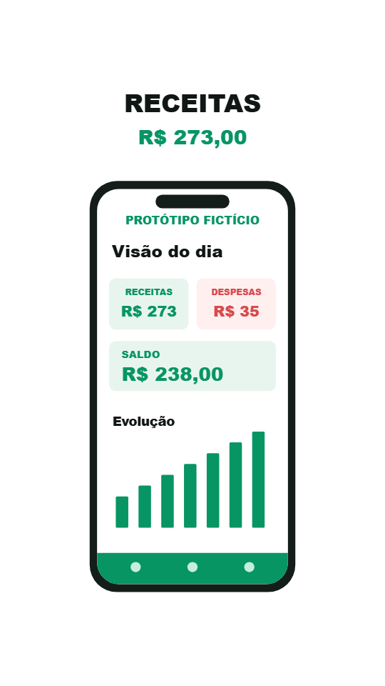

# Demonstrações e evidências

| Arquivo | O que comprova |
|---|---|
| [landscape.mp4](landscape.mp4) | Filme completo de 24 s, 960×540, 30 fps, quatro subframes por frame |
| [portrait.mp4](portrait.mp4) | Mesmo roteiro recomposto em 540×960 |
| [square.mp4](square.mp4) | Mesmo roteiro recomposto em 540×540, sem distorcer o mockup |
| [master-1080p-proof.mp4](master-1080p-proof.mp4) | Trecho de 2 s (12–14 s da timeline), 1920×1080, 60 fps, quatro subframes por frame |
| [morph.mp4](morph.mp4) | Template de 16 s, 270×270/30 fps, sem áudio, para demonstrar o container e loop |
| [three.mp4](three.mp4) | Cena Three.js/WebGL2 de 8 s, 960×540/30 fps e quatro subframes; sem áudio |
| `qa-*.json` | Leitura de streams, decodificação e loudness dos arquivos finais |
| `review-log.md` | Rodadas de inspeção e limitações |
| `beats.json` | Análise medida da trilha sintética nominal de 120 BPM |
| `landscape-contact-*.jpg` | Todos os 24 s em duas folhas de contato |

As demos completas são exportações de validação em resolução reduzida; **não são masters de 24 s em 1080p/60**. O trecho de prova em 1080p/60 valida essa configuração do motor. Para o master completo, rode o comando padrão do README.

O áudio final dos três anúncios de 24 s foi medido em −14,02 LUFS integrados e −2,66 dBTP após AAC. É trilha e SFX sintéticos; não há locução. Não é declarada uma revisão humana auditiva de qualidade musical. A peça é uma demonstração técnica com marca e UI fictícias, não publicidade pronta para uma empresa real.

